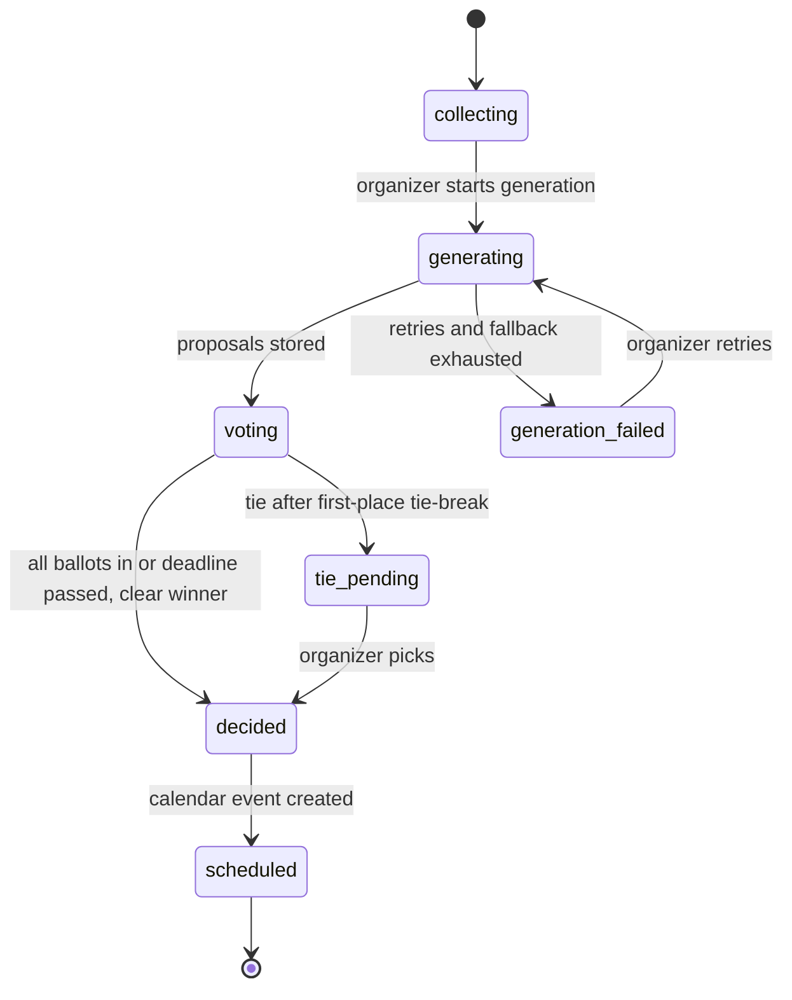

# Right Night — domain glossary

Use these terms in code, UI copy, tickets and commits. Avoid the synonyms listed under each term.

## Terms

**Group**
People who hang out together: a couple or a friend group. Long-lived; it plans many Nights.
*Avoid:* team, party, circle.

**Member**
A person in a Group. Role is `organizer` (created the Group, can start Nights, break ties, retry generation) or `member`.
*Avoid:* participant, user (a *user* is the auth identity; one user can be a member of several groups).

**Invite**
A tokenized URL that lets someone join a Group as a member. It expires.

**Night**
One planning round for a Group within a date window, e.g. "this Friday or Saturday evening". It moves through the state machine below.
*Avoid:* event (reserved for the calendar event), session, round.

**Night input**
One member's input for a Night: availability windows, budget cap per person, vibe tags, free-text notes.
*Avoid:* preferences, survey.

**Proposal**
One AI-generated candidate plan for a Night. A Night gets 2–3. Each has a title, summary, start/end time, estimated cost per person, venues, a weather note and a rationale. `source` is `ai`, or `fallback` when it was built without the LLM.
*Avoid:* option, suggestion, plan (in code).

**Ballot**
A member's full ranking of a Night's Proposals.
*Avoid:* vote (use *vote* only as the verb).

**Decision**
The winning Proposal, chosen by Borda count over all Ballots with tie-breaks ([ADR 0004](docs/adr/0004-ranked-borda-voting.md)).

**Calendar event**
The event n8n creates on the bot Google Calendar for the Decision, with members invited by email.

**Workflow run**
A record of one n8n workflow execution started for a Night: kind, status, attempts, last error, idempotency key.

## Night state machine

Rules:
- Night inputs can only be edited in `collecting`.
- Ballots can only be submitted or changed in `voting`.
- A Night with no Ballots at the deadline goes to `tie_pending`, where the organizer picks.
