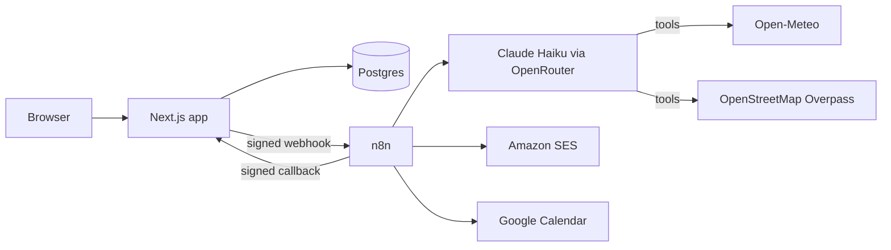

# Right Night

**Find the right night, together.** Date night or squad night, decided.

Right Night is a hangout planner for couples and friend groups. Each member enters their availability, budget and the vibe they're after. An AI agent in an n8n workflow checks the weather and nearby venues and proposes 2–3 plans. Everyone ranks them by email, and the winner lands on everyone's calendar: *Tonight's the Right Night.*

> Status: early development (tickets 00–01 done: scaffold, CI, and the app ⇄ n8n walking skeleton).

## How it works



The app owns state and domain rules. n8n owns orchestration and integrations ([ADR 0002](docs/adr/0002-app-owns-state-n8n-orchestrates.md)).

## Run locally

Needs Node 24, pnpm and Docker.

```bash
cp infra/.env.example infra/.env        # then set N8N_ENCRYPTION_KEY and N8N_SIGNING_SECRET
docker compose -f infra/docker-compose.yml up -d   # Postgres on :5433, n8n on :5678
cp web/.env.example web/.env.local      # same N8N_SIGNING_SECRET as infra/.env
cd web
pnpm install
pnpm db:migrate
pnpm dev                                 # http://localhost:3000
```

Then import and publish the n8n workflows: see [n8n/workflows/README.md](n8n/workflows/README.md).

Tests: `pnpm test` (unit), `pnpm test:integration` (needs the Compose Postgres), `pnpm test:e2e` (Playwright).

## Docs

- [v1 plan](docs/plan.md): decisions, architecture, data model, API, workflows, hosting, verification
- [Domain glossary](CONTEXT.md)
- [Architecture decisions](docs/adr/)
- [Tickets](docs/tickets/), built in order 00 → 10

## Stack

Next.js · TypeScript · Postgres (Drizzle) · Better Auth · n8n · Claude Haiku 5.5 (OpenRouter) · Amazon SES · Google Calendar · Docker Compose · Terraform on AWS EC2
